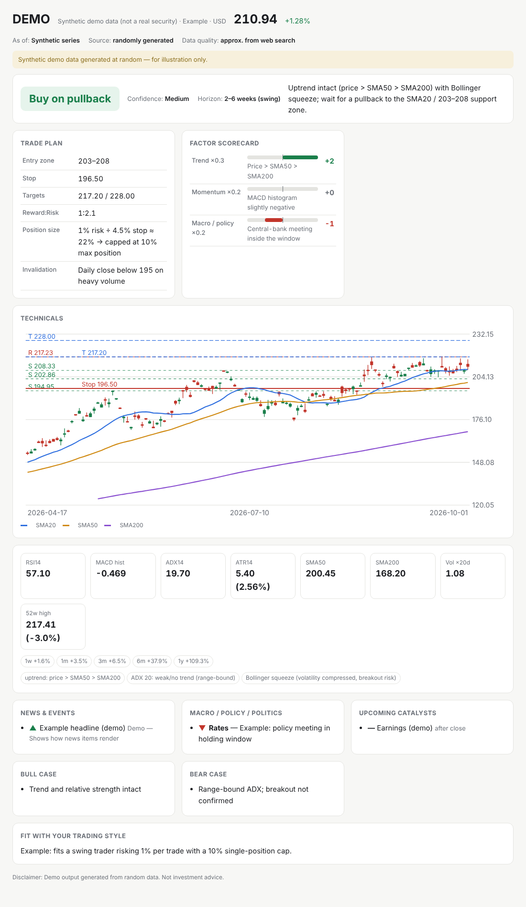

# trade-analyst

A [Claude skill](https://docs.claude.com/en/docs/agents-and-tools/agent-skills/overview) that turns Claude into a personal trading analyst for **US stocks, Canadian (TSX/TSXV) stocks, ETFs and crypto**.

Ask about a ticker ("Should I buy NVDA here?", "I hold SHOP.TO at 140, should I trim?", "What's your view on BTC?"). The skill:

1. **Checks your trading profile.** On first use it asks 8 short questions (holding period, risk per trade, max position size, screen time, leverage, goals…) and remembers the answers, so every later call is sized and timed for *your* style.
2. **Pulls market data and computes technicals.** It gets daily (or intraday) OHLCV and calculates SMA/EMA, RSI, MACD, ADX, ATR, Bollinger Bands, volume ratio, 52-week range, support/resistance pivots and relative strength vs. a benchmark.
3. **Researches the drivers.** It searches company news, the next earnings date, sector moves, the macro calendar (Fed, Bank of Canada, CPI, jobs) and policy/political factors (tariffs, export controls, regulation, elections, crypto rules). Every item carries a date and a source.
4. **Makes a concrete call.** You get one clear action (buy / buy on pullback / hold / trim / sell / wait) with a confidence level, an entry zone, a stop, targets, reward:risk, and a position size computed as `risk % ÷ stop distance %` and capped at your max position. It also lists the bull case, the bear case, and any binary events inside your holding window.
5. **Builds a dashboard.** The result is a self-contained HTML page (candlestick chart with MAs, levels, stop and targets, a factor scorecard, news, catalysts, light/dark mode). If you re-run the analysis on the same ticker, the same page is updated.



*The screenshot is generated from random data; see [`examples/demo-dashboard.html`](examples/demo-dashboard.html).*

## Repository layout

```
trade-analyst/
├── SKILL.md                  # Instructions Claude follows (workflow, profile, TA playbook, macro/politics, output format)
├── scripts/
│   ├── fetch_data.py         # OHLCV + quote + headlines via yfinance (Coinbase fallback for crypto)
│   ├── indicators.py         # Technical snapshot from any OHLCV CSV → JSON
│   └── build_dashboard.py    # Analysis JSON → self-contained HTML dashboard
├── evals/evals.json          # Test prompts used while developing the skill
├── examples/                 # Demo dashboard (synthetic data)
└── requirements.txt
```

## Installation

**Claude apps (claude.ai / desktop / Cowork):** zip the `trade-analyst` folder (the zip should contain the folder itself) and upload it as a custom skill in the skills section of Claude's settings.

**Claude Code:** copy or clone the folder into your skills directory:

```bash
git clone https://github.com/<your-username>/trade-analyst ~/.claude/skills/trade-analyst
```

**Python dependencies** (used by the scripts):

```bash
pip install -r requirements.txt
```

## Usage

Just ask Claude in natural language. English and Chinese both work, and the skill answers in your language:

- "Is AAPL a buy right now? I swing trade, 1% risk per trade."
- "SHOP.TO 现在什么位置？要不要减仓？"
- "BTC outlook for the next few weeks, no leverage."
- "Update my trading profile: I'm a long-term investor now."

You can also use the scripts on their own:

```bash
python scripts/fetch_data.py SHOP.TO --period 1y --out data/SHOP.TO
python scripts/fetch_data.py XIU.TO --period 1y --out data/XIU.TO
python scripts/indicators.py data/SHOP.TO.csv --bench data/XIU.TO.csv > data/SHOP.TO.ta.json
python scripts/build_dashboard.py data/SHOP.TO.analysis.json -o trade-SHOP.TO.html --standalone
```

`indicators.py` accepts any CSV with `Date, Open, High, Low, Close` (and optional `Volume`) columns, for example exports from your broker or TradingView.

## Data sources and limitations

- **Primary:** Yahoo Finance via `yfinance`. Symbols use Yahoo notation: `AAPL`, `BRK-B`, `SHOP.TO`, `BTC-USD`, `^GSPC`.
- **Sandboxed environments:** some environments, including some cloud sandboxes, block finance APIs. In that case the skill falls back, in order, to a browser (if available), public history pages, and finally web search. It labels the data quality (`live` / `delayed` / `approx`) and lowers its confidence accordingly. It never invents prices.
- **Profile storage:** if Claude's memory tool is available, the profile is stored there. Otherwise it goes in `trading_profile.json`. The profile holds only style settings and percentages, never account balances or dollar amounts.
- Data from free sources can be delayed or incomplete. Always check prices in your broker before placing an order.

## Disclaimer

This project is for **informational and educational purposes only** and is **not investment advice**. Markets involve risk, including loss of principal. You are solely responsible for your trading decisions. The authors accept no liability for any losses.

## License

[MIT](LICENSE)
